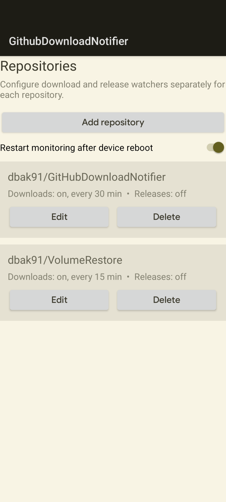
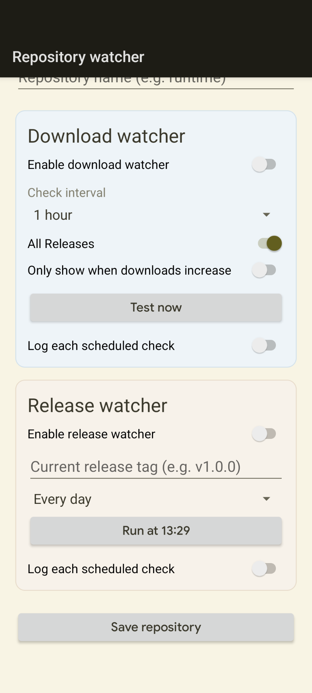

# GitHub Download Notifier

GitHub Download Notifier is a .NET 10 Android app that monitors GitHub release-asset download counts and new GitHub releases. Multiple repositories can be configured independently from the repository dashboard.





## Behavior

1. Add a repository from the dashboard.
2. Enter the GitHub repository owner and repository name.
3. Enable its download watcher and select how frequently GitHub should be checked.
4. Choose whether counts include all releases or only the latest release.
5. Choose whether every successful check produces a notification or notifications are only sent when downloads increase.
6. Optionally enable the release watcher, enter the current tag, and select its schedule.
7. Save the repository.

Each enabled repository has its own WorkManager job, comparison baseline, and last-run status. The first successful check establishes its baseline. Later checks compare the current total with the stored total for that repository and release scope.

## Check intervals

Available intervals are:

- 15 minutes
- 30 minutes
- 1 hour
- 12 hours
- 1 day
- Custom interval in minutes or days

Day-based schedules include a local run-at time. It defaults to the time when the day schedule is configured and can be changed before saving.

## Release watcher

The release watcher compares GitHub's latest release tag with the configured current tag and sends one notification when a different tag is found. Available schedules are 1 day, 3 days, 7 days, 1 month, and custom days. All release schedules include a local target run-at time.

Download and release watchers have independent schedules and WorkManager jobs for each repository.

## Interval logging

Download and release watchers can independently append a CSV record after every scheduled check, including failed checks. Enable logging in the relevant watcher panel, create or choose a CSV document through Android's file picker, and select the statistics to include.

Available statistics include timestamps, repository and status details, download totals and deltas, release tags and metadata, and errors. The selected columns are written in the configured order. Manual **Test now** checks do not write log records.

## Release scope

- **All Releases** sums the `download_count` values of release assets across up to the latest 100 GitHub releases.
- **Latest Only** sums release-asset downloads from the latest release.

Separate comparison baselines are maintained for each scope, so changing scope does not compare unrelated totals.

## Notification modes

- **Only show when downloads increase** sends a notification only when the current total is greater than the previous total.
- **Always show each check** reports every successful scheduled check, including no-change and first-check results.

WorkManager runs checks in the background without a persistent monitoring notification. Failed checks do not produce download-update notifications, and the next configured occurrence is still scheduled.

## Test Now

**Test now** immediately queries GitHub and sends a notification containing:

- The current download total for the selected release scope.
- The difference from the previous stored total.

The test also updates the stored comparison baseline.

## Android permissions

The app uses:

- Internet access for GitHub API requests.
- Foreground-service permission for scheduled monitoring.
- Notification permission on Android 13 and newer.

Notification permission is requested when background monitoring is first enabled or when **Test now** is used, unless permission was already granted.

## Service lifetime

Monitoring uses chained one-time Android WorkManager jobs. Android may delay checks to optimize battery use, minute intervals have a minimum of 15 minutes, and day run-at times are targets rather than exact alarms. WorkManager preserves scheduled work across app process and device restarts without a custom boot receiver. The app displays a one-time warning with a shortcut to Android battery optimization settings when monitoring is first enabled.

The dashboard includes an optional **Restart monitoring after device reboot** setting. When enabled, Android silently restores enabled download and release schedules after boot; it does not open the app or send a boot notification.

## GitHub API considerations

The app currently uses unauthenticated GitHub API requests. GitHub rate limits therefore apply. Very large repositories with more than 100 releases are limited to the first API page when **All Releases** is selected.

To preserve capacity under GitHub's unauthenticated limit, configurations with more than 15 repositories are projected before saving. Saves are blocked when the complete configuration could schedule more than 100 requests in any rolling 60-minute window. The projection considers all enabled download and release watchers, intervals, and configured run-at times. Existing settings keep running, but cannot be saved again while the proposed configuration exceeds the budget. Manual **Test now** requests are not included or blocked.

## Build and publish

Build the project with the .NET 10 Android workload installed:

```powershell
dotnet build GithubDownloadNotifier.slnx
```

Publish APK files:

```powershell
dotnet publish GithubDownloadNotifier\GithubDownloadNotifier.csproj -c Release -f net10.0-android /p:AndroidPackageFormat=apk
```

Published APK files are written under:

`GithubDownloadNotifier\bin\Release\net10.0-android\publish`

## License

Copyright (c) 2026 David Baker.

The source is available for personal, educational, research, charitable, and nonprofit use. Commercial use requires prior written permission. See the [Noncommercial Source License](LICENSE) for the complete terms.
